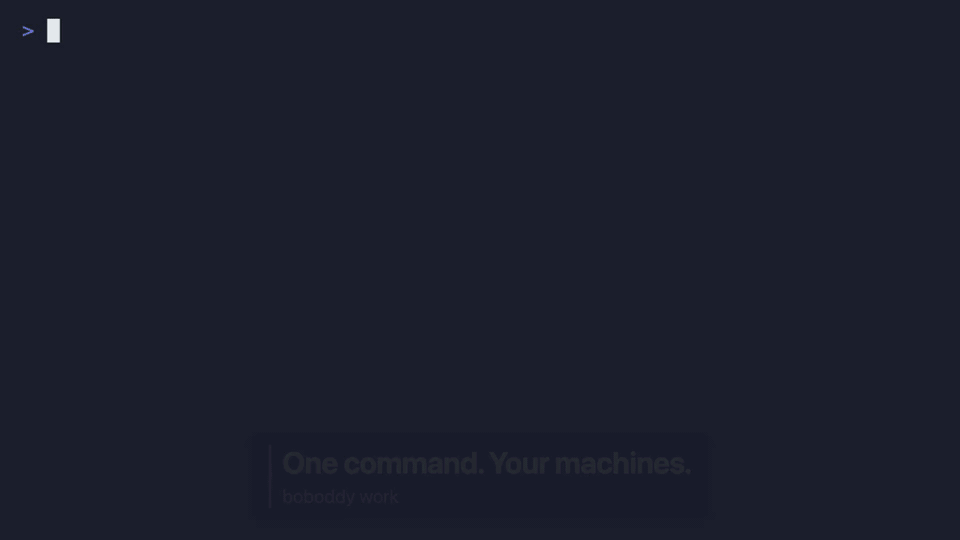

# Scarn

Scarn runs AI agents over your issues in multi-step pipelines. A worker runs on your machine with your AI provider; the dashboard shows what happened at each step, including reports, traces, and proposed changes.

## Star the repo

If you find it useful, [star the repo](https://github.com/scarn-io/scarn).



[Watch the 75-second walkthrough](https://scarn.io/hero.mp4)

## The problem

A bug lands in your tracker. Someone has to read it, work out if it's even actionable, ask the reporter for the missing details, pull the branch, reproduce it, and _then_ start fixing. Most of that is not engineering — it's legwork that gets done late, by whoever draws the short straw.

**Scarn does the legwork.** By the time a human opens the ticket, there's already a report on what was tried, a trace of the bug happening, a failing test that proves it, and a fix waiting for approval.

## How it works

Work items come from GitHub, Bitbucket or Jira issues, or are created by hand. Each one can start a pipeline.

Pipelines define what an agent does at each step and when the work can move on. For example, an issue can be triaged, reproduced in a browser, and fixed only after a human approves the change. The agent does the work; pipeline rules decide whether the result is enough to continue.

Workers run in your repository's environment, on your hardware, optionally inside its devcontainer. You bring your own AI provider, and agents use the MCP servers and skills your repository already defines. The server stores pipelines, run history and artifacts (reports, Playwright traces); execution happens on your workers, so your code stays on your machines.

## Hosted or self-hosted

**Hosted.** Sign up at [app.scarn.io](https://app.scarn.io) and connect a worker:

```sh
npm i -g @scarn/cli
cd your-repo
scarn init
scarn work
```

You'll need a repository with an `origin` remote, Node or Bun, and an AI provider supported by [OpenCode](https://opencode.ai). `scarn init` links the repo to a project and helps you design a pipeline. `scarn work` starts a worker to run it. See the [full quickstart](https://scarn-io.github.io/scarn/getting-started/quickstart/) if you need help connecting a provider or setting up a devcontainer.

**Self-hosted.** The whole server (API, web app, Postgres and S3-compatible storage) runs with Docker Compose from `docker-compose.selfhost.yml` in this repo. Self-hosted installs have no usage limits. Start with the [self-hosting quickstart](https://scarn-io.github.io/scarn/self-hosting/quickstart/), then [connect the GitHub App](https://scarn-io.github.io/scarn/self-hosting/github-app/) and [point the CLI at your server](https://scarn-io.github.io/scarn/self-hosting/cli/).

## What's open and what's paid

Scarn is open core. Everything an individual or a small team needs is open source in this repository:

- projects, work items, pipelines, steps, signals, rules and the pipeline designer
- workers, the CLI, the SDK and the OpenCode plugin
- GitHub, Bitbucket and Jira ingest
- orgs, members, invites and built-in roles
- secrets, environments, notifications, artifacts and traces
- usage metering (limits apply only on the hosted service)

Paid plans will add what larger companies need to roll Scarn out across many teams: workflow guardrails such as required approvers and protected pipelines, and identity, governance and compliance features such as SSO, SCIM and audit logs. None of these exist yet. When they do, they will be available on the hosted service and, with a license key, on self-hosted installs. Features that are open stay open.

## Repository layout

| Path                          | What it is                                                                                       |
| ----------------------------- | ------------------------------------------------------------------------------------------------ |
| `apps/api`                    | HTTP API (Elysia), mounted under `/api`                                                          |
| `apps/next`                   | Web app (Next.js)                                                                                |
| `apps/cli`                    | The `scarn` CLI, published as [`@scarn/cli`](https://www.npmjs.com/package/@scarn/cli)           |
| `apps/docs`                   | The [documentation site](https://scarn-io.github.io/scarn/) (Astro Starlight)                    |
| `apps/work-signal`            | Optional Cloudflare Worker that wakes idle workers and streams live logs                         |
| `packages/core`               | Domain and application logic                                                                     |
| `packages/identity`           | Authentication, sessions and access tokens                                                       |
| `packages/worker`             | Runs tasks on a machine; used by the CLI                                                         |
| `packages/sdks/js`            | The TypeScript SDK (`@scarn/sdk`)                                                                |
| `packages/opencode-plugin`    | OpenCode plugin used by workers                                                                  |
| `packages/*` (others)         | Supporting packages: containers, observability, shared-core, design tokens, studio UI, local dev |
| `docker-compose.selfhost.yml` | Self-hosted server                                                                               |

[Docs](https://scarn-io.github.io/scarn/) · [CLI](apps/cli) · [SDK](packages/sdks/js) · [Open an issue](https://github.com/scarn-io/scarn/issues)

## Contributing

This repository is synced from a private monorepo. Pull requests are welcome; they are ported over with credit. See [CONTRIBUTING.md](CONTRIBUTING.md). To report a vulnerability, see [SECURITY.md](SECURITY.md).

## License

[Apache License 2.0](LICENSE). See [NOTICE](NOTICE).

## Why "Scarn"?

This repo strives to make your agents to be just as effective as the best agent of all time, Michael Scarn.
