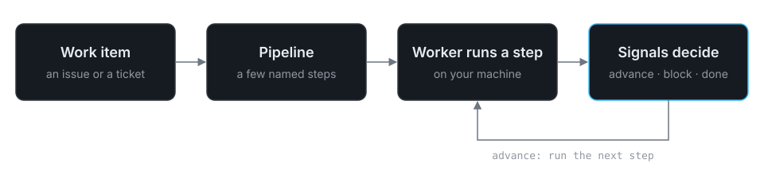

import { CardGrid, LinkCard } from '@astrojs/starlight/components';

Scarn runs AI agents over your backlog, on your machines. You say what
should come out the other end, what evidence you need to trust it, and what
must never be touched; the agents work out the path. A worker on your laptop
or CI box runs a pipeline against each work item that arrives.

The first pipeline is a default bug pipeline. For each bug report it checks
there's enough to act on, then investigates and reproduces the bug, writes a
failing test, and proposes a fix. What you get back is an investigation
report, a Playwright trace when the app is reachable, the test, and the fix.
The designer adapts it to your repository, using the MCP servers and skills it
finds there.



## You'll need

- A git repository with a remote — see [Installation](/scarn/getting-started/installation/#requirements).
- Node.js or Bun — see [Installation](/scarn/getting-started/installation/#requirements).
- Claude Code, Codex, or GitHub Copilot, or an API key from any AI provider — see
  [Installation](/scarn/getting-started/installation/#requirements).

## Where to go next

<CardGrid>
  <LinkCard
    title="Quickstart"
    description="Ten minutes to a running pipeline."
    href="/scarn/getting-started/quickstart/"
  />
  <LinkCard
    title="Core concepts"
    description="The dozen words the rest of the docs assume."
    href="/scarn/getting-started/concepts/"
  />
  <LinkCard
    title="CLI reference"
    description="Every scarn command and flag."
    href="/scarn/reference/cli/"
  />
</CardGrid>

## Start now

```bash
npm i -g @scarn/cli && scarn init
```
